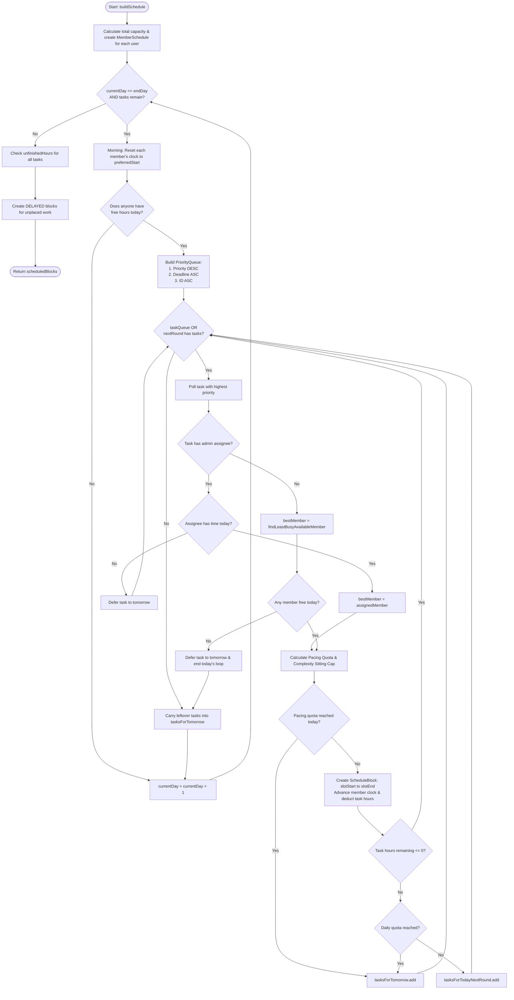

# Complete Code Walkthrough: Group Schedule Builder
### An In-Depth, Line-by-Line Guide for the OCR A-Level Computer Science NEA

> **File Reference:** [`GroupScheduleBuilder.java`](file:///c:/Users/Nekretaur/Documents/school-projects/agamotto/src/main/java/com/srikrishnanethi/agamotto/service/scheduler/group/GroupScheduleBuilder.java)  
> **Companion Class:** [`MemberSchedule.java`](file:///c:/Users/Nekretaur/Documents/school-projects/agamotto/src/main/java/com/srikrishnanethi/agamotto/service/scheduler/group/MemberSchedule.java)  
> **Test Suite:** [`GroupScheduleBuilderTest.java`](file:///c:/Users/Nekretaur/Documents/school-projects/agamotto/src/test/java/com/srikrishnanethi/agamotto/service/scheduler/group/GroupScheduleBuilderTest.java)

---

## 1. High-Level Overview: What Does This Component Do?

In a team project, multiple people have different working hours, personal preferences (e.g. whether they work weekends), and task assignments. Some tasks are assigned by an admin to a specific person, while others are unassigned and need to be distributed fairly across the team. Furthermore, students must not be scheduled into 5-hour cramming marathons that lead to burnout.

The **[`GroupScheduleBuilder`](file:///c:/Users/Nekretaur/Documents/school-projects/agamotto/src/main/java/com/srikrishnanethi/agamotto/service/scheduler/group/GroupScheduleBuilder.java)** solves this using an **event-driven daily calendar simulation with heuristic greedy load balancing**:
1. It simulates moving through time day by day (`startDay` $\rightarrow$ `endDay`).
2. Each morning, it prioritises remaining tasks into a binary heap (`PriorityQueue`).
3. For each task, it checks whether an admin designated an assignee; if not, it balances load by assigning it to whichever team member has the lowest relative workload percentage (`busyPercentage`).
4. It breaks long tasks across days (**daily pacing**) and caps continuous work according to task complexity (**anti-burnout session caps**).
5. If tasks cannot fit before the project deadline, it marks the remaining hours as **`DELAYED`** with a precise explanation.

---

## 2. Key Data Structures & Design Decisions

Before reading the lines of code, you must understand *why* each data structure was chosen. These points are essential for your NEA Technical Solution and Viva defense:

| Data Structure | Where Used | Why It Was Chosen Over Alternatives |
| :--- | :--- | :--- |
| **`PriorityQueue<Task>`** (Binary Heap) | Ordering today's tasks | Provides $O(\log n)$ insertion and removal. Tasks are ordered by **Priority** (descending), then **Deadline** (ascending), then **ID** (tie-breaker). Sorting a plain `ArrayList` repeatedly would take $O(n \log n)$. |
| **`IdentityHashMap<Task, Double>`** | `unfinishedHours`, `hoursPlacedToday` | Compares keys strictly by memory address reference (`==`) rather than `.equals()` or `.hashCode()`. If a `Task` entity is mutated during the simulation, a standard `HashMap` could compute a different hash bucket and lose state. `IdentityHashMap` guarantees bulletproof $O(1)$ lookup. |
| **`LinkedHashMap<String, MemberSchedule>`** | `memberSchedules` | Maintains predictable insertion order for deterministic simulation across runs, while giving $O(1)$ lookup by `userId` when an admin-assigned member must be found. |
| **`LinkedHashSet<Task>`** | `tasksForTomorrow`, `tasksForToday` | Ensures task uniqueness ($O(1)$ contains/add) while strictly preserving FIFO insertion order for reproducibility. |
| **`double EPSILON = 1e-9`** | Floating-point zero checks | In Java, binary floating-point math (`double`) cannot represent every decimal fraction exactly (e.g. $0.1 + 0.2 \neq 0.3$). Without epsilon comparisons, a task with `0.0000000001` hours remaining would never terminate. |

---

## 3. Line-by-Line Walkthrough: `GroupScheduleBuilder.java`

Let us walk through the entire file from top to bottom, explaining the purpose and mechanics of every line.

---

### Step 1: Package, Imports, and Injected Dependencies (Lines 1–30)

```java
1: package com.srikrishnanethi.agamotto.service.scheduler.group;
2: 
3: import com.srikrishnanethi.agamotto.entities.ScheduleBlock;
4: import com.srikrishnanethi.agamotto.entities.Task;
5: import com.srikrishnanethi.agamotto.entities.User;
6: import com.srikrishnanethi.agamotto.entities.UserProfile;
7: import com.srikrishnanethi.agamotto.entities.enums.BlockDecision;
8: import com.srikrishnanethi.agamotto.service.scheduler.ScheduleBuilder;
9: import com.srikrishnanethi.agamotto.service.scheduler.ScoringStrategy;
10: import org.springframework.stereotype.Component;
11: 
12: import java.time.LocalDate;
13: import java.time.LocalDateTime;
14: import java.time.temporal.ChronoUnit;
15: import java.util.*;
16: 
17: /**
18:  * Schedules group tasks onto member calendars using admin assignments and pacing.
19:  */
20: @Component
21: public class GroupScheduleBuilder {
22: 
23:     private static final double EPSILON = 1e-9;
24:     private static final double MINUTES_PER_HOUR = 60.0;
25: 
26:     private final ScoringStrategy scoringStrategy;
27: 
28:     public GroupScheduleBuilder(ScoringStrategy scoringStrategy) {
29:         this.scoringStrategy = scoringStrategy;
30:     }
```

#### Line Explanations:
* **Lines 20–21 (`@Component public class GroupScheduleBuilder`)**: Marks this class as a Spring-managed singleton bean so it can be injected into [`SchedulePlanServiceImpl`](file:///c:/Users/Nekretaur/Documents/school-projects/agamotto/src/main/java/com/srikrishnanethi/agamotto/service/impl/SchedulePlanServiceImpl.java).
* **Line 23 (`private static final double EPSILON = 1e-9;`)**: Threshold used for floating-point comparisons. We treat any value $< 10^{-9}$ as zero to prevent rounding bugs.
* **Line 24 (`private static final double MINUTES_PER_HOUR = 60.0;`)**: A named constant avoiding magic numbers when converting fractional hours (e.g. $1.5\text{ h}$) into clock minutes ($90\text{ mins}$).
* **Lines 26–30 (`public GroupScheduleBuilder(...)`)**: Constructor dependency injection. Injects [`ScoringStrategy`](file:///c:/Users/Nekretaur/Documents/school-projects/agamotto/src/main/java/com/srikrishnanethi/agamotto/service/scheduler/ScoringStrategy.java), which handles reading calibrated task duration (`getEffectiveDurationHours(task)`).

---

### Step 2: Method Signature, Guard Clauses, and Member Capacity (Lines 32–50)

```java
32:     public List<ScheduleBlock> buildSchedule(
33:             List<Task> tasks,
34:             LocalDate startDay,
35:             LocalDate endDay,
36:             Map<User, UserProfile> teamProfiles) {
37: 
38:         List<ScheduleBlock> scheduledBlocks = new ArrayList<>();
39:         if (tasks == null || tasks.isEmpty() || teamProfiles.isEmpty()) {
40:             return scheduledBlocks;
41:         }
42: 
43:         // 1. Create a schedule tracker for each team member
44:         Map<String, MemberSchedule> memberSchedules = new LinkedHashMap<>();
45:         for (Map.Entry<User, UserProfile> entry : teamProfiles.entrySet()) {
46:             User user = entry.getKey();
47:             UserProfile profile = entry.getValue();
48:             double totalHours = calculateTotalWorkingHours(startDay, endDay, profile);
49:             memberSchedules.put(user.getId(), new MemberSchedule(user, profile, startDay, totalHours));
50:         }
```

#### Line Explanations:
* **Lines 32–36**: The entry point method. Takes:
  * `tasks`: All schedulable tasks in the project.
  * `startDay` & `endDay`: The date range for the scheduling window.
  * `teamProfiles`: A map pairing each [`User`](file:///c:/Users/Nekretaur/Documents/school-projects/agamotto/src/main/java/com/srikrishnanethi/agamotto/entities/User.java) with their personal [`UserProfile`](file:///c:/Users/Nekretaur/Documents/school-projects/agamotto/src/main/java/com/srikrishnanethi/agamotto/entities/UserProfile.java) (working hours, weekend settings).
* **Lines 38–41**: Initialises the result list `scheduledBlocks`. A **defensive guard clause** returns immediately if there are no tasks to schedule or if the team has no members, preventing `NullPointerException`s downstream.
* **Line 44**: Creates `memberSchedules` as a `LinkedHashMap<String, MemberSchedule>` keyed by `user.getId()`.
* **Lines 45–50**: Iterates over every team member:
  * Line 48 calls `calculateTotalWorkingHours(...)` to find the member's total potential capacity between `startDay` and `endDay`.
  * Line 49 instantiates a [`MemberSchedule`](file:///c:/Users/Nekretaur/Documents/school-projects/agamotto/src/main/java/com/srikrishnanethi/agamotto/service/scheduler/group/MemberSchedule.java) object to track their daily clock and busy ratio.

---

### Step 3: Tracking Remaining Work via Memory Addresses (Lines 52–56)

```java
52:         // 2. Track remaining hours for each task using object memory address
53:         Map<Task, Double> unfinishedHours = new IdentityHashMap<>();
54:         for (Task task : tasks) {
55:             unfinishedHours.put(task, scoringStrategy.getEffectiveDurationHours(task));
56:         }
```

#### Line Explanations:
* **Line 53 (`new IdentityHashMap<>()`)**: Initialises the task work ledger. Uses reference equality (`==`) so the map tracks the exact task instance regardless of entity state modifications.
* **Lines 54–56**: Populates the ledger with each task's effective duration in hours (accounting for user-corrected estimates).

---

### Step 4: The Daily Simulation Loop & Morning Clock Reset (Lines 58–84)

```java
58:         // 3. Step day-by-day through the calendar
59:         Set<Task> tasksForTomorrow = new LinkedHashSet<>(tasks);
60:         LocalDate currentDay = startDay;
61:         while (!currentDay.isAfter(endDay) && !tasksForTomorrow.isEmpty()) {
62: 
63:             // Reset each team member's clock to their morning start time
64:             for (MemberSchedule member : memberSchedules.values()) {
65:                 if (member.getProfile().isIncludeWeekends() || !isWeekend(currentDay)) {
66:                     member.startNewDay(currentDay);
67:                 } else {
68:                     // Weekend: Mark day as booked if member does not work weekends
69:                     member.startNewDay(currentDay);
70:                     member.bookTime(member.getNextFreeTime(), member.getFreeHoursToday());
71:                 }
72:             }
73: 
74:             // Start of day: query tasksForTomorrow to obtain today's workload
75:             Set<Task> tasksForToday = new LinkedHashSet<>(tasksForTomorrow);
76:             tasksForTomorrow.clear();
77: 
78:             boolean anyMemberCanWorkToday = memberSchedules.values().stream().anyMatch(m -> m.getFreeHoursToday() > EPSILON);
79:             if (!anyMemberCanWorkToday) {
80:                 tasksForTomorrow.addAll(tasksForToday);
81:                 currentDay = currentDay.plusDays(1);
82:                 continue;
83:             }
```

#### Line Explanations:
* **Line 59**: `tasksForTomorrow` initially contains all tasks. At the start of Day 1, these become `tasksForToday`.
* **Line 60–61**: Main calendar loop. Steps forward day-by-day until `endDay` is passed **or** all tasks are finished (`tasksForTomorrow.isEmpty()`).
* **Lines 64–72 (Morning Reset)**:
  * If today is a weekday, or if the member enabled `isIncludeWeekends()`, `member.startNewDay(currentDay)` resets their clock to their morning `preferredStart` (e.g. 09:00) and calculates their daily capacity.
  * If it is a weekend and the member does *not* work weekends, line 70 immediately books all their hours today (`bookTime(..., getFreeHoursToday())`), effectively leaving them with 0 free hours today without penalising their workload ratio.
* **Lines 75–76**: Transfers yesterday's carryover into `tasksForToday` and clears `tasksForTomorrow` to receive tasks deferred during today's placements.
* **Lines 78–83 (Day Skip Check)**: Checks if *anyone* in the team has working hours today (`freeHoursToday > EPSILON`). If it is Sunday and nobody works, lines 80–82 roll all tasks forward into `tasksForTomorrow`, increment `currentDay`, and immediately skip to the next day.

---

### Step 5: Prioritising Today's Work with a Binary Heap (Lines 85–99)

```java
85:             // Put unfinished tasks into a priority queue (highest priority first, then earliest deadline, then alphabetically)
86:             PriorityQueue<Task> taskQueue = new PriorityQueue<>(Comparator
87:                     .comparingInt(Task::getPriority).reversed()
88:                     .thenComparing(Task::getDeadline)
89:                     .thenComparing(t -> t.getId() == null ? "" : t.getId()));
90: 
91:             for (Task t : tasksForToday) {
92:                 if (unfinishedHours.getOrDefault(t, 0.0) > EPSILON) {
93:                     taskQueue.add(t);
94:                 }
95:             }
96: 
97:             List<Task> tasksForTodayNextRound = new ArrayList<>();
98:             Map<Task, Double> hoursPlacedToday = new IdentityHashMap<>();
```

#### Line Explanations:
* **Lines 86–89**: Initialises a `PriorityQueue<Task>` with a 3-tier comparator:
  1. `Task::getPriority.reversed()`: Higher priority numbers (e.g. 5) come first.
  2. `Task::getDeadline`: Earlier deadlines come first if priorities are equal.
  3. `Task::getId`: Deterministic tie-breaker ensuring the exact same ordering every run.
* **Lines 91–95**: Enqueues all tasks that still have unfinished work (`> EPSILON`).
* **Line 97 (`tasksForTodayNextRound`)**: An auxiliary list supporting **round-robin intra-day scheduling**. When a task receives a slice of time today, it goes into this secondary list so other tasks get a turn before this task receives a second block on the same day.
* **Line 98 (`hoursPlacedToday`)**: Tracks how many hours each task has received *today*, used to enforce the daily pacing quota.

---

### Step 6: Daily Placement Loop & Member Routing (Lines 101–133)

```java
101:             // Place tasks into available calendar slots today
102:             while (!taskQueue.isEmpty() || !tasksForTodayNextRound.isEmpty()) {
103:                 // Query tasksForTodayNextRound when current round finishes
104:                 if (taskQueue.isEmpty()) {
105:                     taskQueue.addAll(tasksForTodayNextRound);
106:                     tasksForTodayNextRound.clear();
107:                 }
108: 
109:                 Task task = taskQueue.poll();
110:                 double hoursLeftOnTask = unfinishedHours.getOrDefault(task, 0.0);
111:                 if (hoursLeftOnTask <= EPSILON) {
112:                     continue; // Task is already completed
113:                 }
114: 
115:                 // Route to admin-assigned member, or balance if unassigned
116:                 MemberSchedule bestMember;
117:                 if (Objects.requireNonNull(task).getAssignee() != null && memberSchedules.containsKey(task.getAssignee().getId())) {
118:                     MemberSchedule assignedMember = memberSchedules.get(task.getAssignee().getId());
119:                     if (assignedMember.getFreeHoursToday() > EPSILON) {
120:                         bestMember = assignedMember;
121:                     } else {
122:                         // Assigned member has no free time left today; defer to tomorrow
123:                         tasksForTomorrow.add(task);
124:                         continue;
125:                     }
126:                 } else {
127:                     bestMember = findLeastBusyAvailableMember(memberSchedules.values());
128:                 }
129: 
130:                 if (bestMember == null || bestMember.getFreeHoursToday() <= EPSILON) {
131:                     tasksForTomorrow.add(task);
132:                     break;
133:                 }
```

#### Line Explanations:
* **Lines 102–107**: While either today's queue or today's next round has tasks: if the primary queue empties, it re-fills from `tasksForTodayNextRound` to start Round 2.
* **Lines 109–113**: Extracts the highest-urgency task (`poll()`). If it has 0 remaining hours, it skips it.
* **Lines 116–128 (Routing Logic)**:
  * **Admin Assigned Task (Lines 117–125)**: If the task has an assignee designated by the project admin:
    * If that member has free time today (`> EPSILON`), they are selected (`bestMember = assignedMember`).
    * If that member is fully booked today, the task **cannot** be stolen by another team member. It is deferred to tomorrow (`tasksForTomorrow.add(task); continue;`).
  * **Unassigned Task (Line 127)**: If no assignee was designated, `findLeastBusyAvailableMember(...)` is called. It inspects all members who have free time today and picks the one with the lowest `busyPercentage`.
* **Lines 130–133**: If `bestMember == null` (the entire team has run out of time today), the task is deferred to tomorrow and today's scheduling loop terminates (`break`).

---

### Step 7: The Anti-Burnout Engine (Pacing & Session Caps) (Lines 134–165)

```java
134:                 // Decompose task across working days before deadline to avoid fatigue
135:                 long daysRemaining = countWorkingDaysUntilDeadline(currentDay, task, endDay, bestMember.getProfile());
136:                 double maxSittingHours = maxHoursPerSitting(task.getComplexity());
137:                 double alreadyPlacedToday = hoursPlacedToday.getOrDefault(task, 0.0);
138: 
139:                 double dailyQuota;
140:                 if (daysRemaining <= 1) {
141:                     dailyQuota = hoursLeftOnTask;
142:                 } else {
143:                     double dailyPace = hoursLeftOnTask / daysRemaining;
144:                     dailyQuota = Math.max(0.5, Math.ceil(dailyPace * 2.0) / 2.0);
145:                 }
146: 
147:                 double quotaLeftToday = Math.max(0.0, dailyQuota - alreadyPlacedToday);
148:                 if (daysRemaining > 1 && quotaLeftToday <= EPSILON) {
149:                     // Today's quota reached; defer remainder to tomorrow
150:                     tasksForTomorrow.add(task);
151:                     continue;
152:                 }
153: 
154:                 double targetSessionHours = Math.min(hoursLeftOnTask, maxSittingHours);
155:                 if (daysRemaining > 1) {
156:                     targetSessionHours = Math.min(targetSessionHours, quotaLeftToday);
157:                 }
158: 
159:                 // If this sitting doesn't fit in the member's remaining time today, try tomorrow
160:                 if (targetSessionHours > bestMember.getFreeHoursToday() + EPSILON
161:                         && hoursLeftOnTask > bestMember.getFreeHoursToday() + EPSILON) {
162:                     tasksForTomorrow.add(task);
163:                     continue;
164:                 }
```

#### Line Explanations:
* **Line 135**: Calls `countWorkingDaysUntilDeadline(...)` to find how many working days this member has left before the task's deadline.
* **Line 136**: Calls `maxHoursPerSitting(complexity)`:
  * Complexity 1–2: Max **30 minutes** ($0.5\text{ h}$).
  * Complexity 3: Max **1 hour** ($1.0\text{ h}$).
  * Complexity 4–5: Max **2 hours** ($2.0\text{ h}$).
* **Lines 139–145 (Daily Pacing Quota)**:
  * If `daysRemaining <= 1` (Deadline is today or tomorrow): **Panic Mode**! `dailyQuota = hoursLeftOnTask` so as much work as possible is scheduled immediately.
  * If `daysRemaining > 1`: Calculates `dailyPace = hoursLeftOnTask / daysRemaining`. Line 144 rounds up to the nearest half-hour using `Math.ceil(dailyPace * 2.0) / 2.0` (with a minimum of 0.5h).
* **Lines 147–152**: Calculates `quotaLeftToday`. If the task has already reached its daily quota today, it is deferred to `tasksForTomorrow`.
* **Lines 154–157**: `targetSessionHours` is the minimum of remaining task hours, the complexity sitting cap, and today's remaining pacing quota.
* **Lines 160–164 (Clean Slot Fit)**: If this sitting does not fit in the member's remaining time today and the task is larger than what remains today, defer it to tomorrow so it can start fresh in the morning rather than creating an awkward, fragmented sliver.

---

### Step 8: Booking the Time Block & Updating Clocks (Lines 166–200)

```java
166:                 // Calculate the actual hours and minutes to book
167:                 double hoursToBook = Math.min(targetSessionHours, bestMember.getFreeHoursToday());
168:                 long minutesToBook = Math.round(hoursToBook * MINUTES_PER_HOUR);
169:                 if (minutesToBook <= 0) {
170:                     tasksForTomorrow.add(task);
171:                     continue;
172:                 }
173: 
174:                 LocalDateTime slotStart = bestMember.getNextFreeTime();
175:                 LocalDateTime slotEnd = slotStart.plusMinutes(minutesToBook);
176: 
177:                 boolean isTaskSplit = hoursLeftOnTask > hoursToBook + EPSILON;
178:                 boolean isSessionCapped = isTaskSplit && hoursToBook >= maxSittingHours - EPSILON;
179:                 boolean isDecomposedAcrossDays = isTaskSplit && daysRemaining > 1;
180: 
181:                 String explanation = makeSlotExplanation(
182:                         task, bestMember.getUser(), bestMember.getBusyPercentage(),
183:                         hoursToBook, currentDay, isTaskSplit, isSessionCapped, maxSittingHours, isDecomposedAcrossDays);
184: 
185:                 // Create the scheduled calendar block
186:                 ScheduleBlock block = new ScheduleBlock();
187:                 block.setTask(task);
188:                 block.setStartTime(slotStart);
189:                 block.setEndTime(slotEnd);
190:                 block.setDecision(BlockDecision.SCHEDULED);
191:                 block.setReason(ScheduleBuilder.clampReason(explanation));
192:                 block.setManuallyOverridden(false);
193:                 scheduledBlocks.add(block);
194: 
195:                 // Update member's clock and deduct the booked hours from the task
196:                 bestMember.bookTime(slotEnd, hoursToBook);
197:                 hoursLeftOnTask -= hoursToBook;
198:                 unfinishedHours.put(task, hoursLeftOnTask);
199:                 hoursPlacedToday.put(task, alreadyPlacedToday + hoursToBook);
```

#### Line Explanations:
* **Lines 167–172**: Confirms `hoursToBook` fits in the member's remaining hours today. Converts hours to integer minutes (`Math.round(hoursToBook * 60.0)`).
* **Lines 174–175**: Calculates exact calendar timestamps. `slotStart` is the member's `nextFreeTime` (e.g. 09:00 AM). `slotEnd` is `slotStart.plusMinutes(minutesToBook)` (e.g. 10:00 AM).
* **Lines 177–183**: Computes explanation flags:
  * `isTaskSplit`: Task still has work left over after this sitting.
  * `isSessionCapped`: Task was cut short specifically due to the complexity sitting cap.
  * `isDecomposedAcrossDays`: Task was paced because multiple days remain.
  * Line 181 calls `makeSlotExplanation(...)` to generate human-readable text for the UI.
* **Lines 186–193**: Constructs a [`ScheduleBlock`](file:///c:/Users/Nekretaur/Documents/school-projects/agamotto/src/main/java/com/srikrishnanethi/agamotto/entities/ScheduleBlock.java) with `BlockDecision.SCHEDULED` and appends it to `scheduledBlocks`.
* **Lines 196–199 (State Updates)**:
  * `bestMember.bookTime(slotEnd, hoursToBook)`: Advances member's clock to `slotEnd`, subtracts `hoursToBook` from their free hours today, and adds `hoursToBook` to their `scheduledHours`.
  * `hoursLeftOnTask -= hoursToBook`: Updates task's remaining hours in `unfinishedHours`.
  * `hoursPlacedToday.put(...)`: Updates today's placed total for pacing.

---

### Step 9: Re-Queueing vs Tomorrow & Advancing Calendar (Lines 201–219)

```java
201:                 // Re-queue remaining work: into today's next round if quota remains, or tomorrow if quota is reached
202:                 if (hoursLeftOnTask > EPSILON) {
203:                     double newPlacedToday = alreadyPlacedToday + hoursToBook;
204:                     if (daysRemaining > 1 && newPlacedToday >= dailyQuota - EPSILON) {
205:                         tasksForTomorrow.add(task);
206:                     } else {
207:                         tasksForTodayNextRound.add(task);
208:                     }
209:                 }
210:             }
211: 
212:             // Carry over any unplaced tasks from today's queues into tomorrow
213:             tasksForTomorrow.addAll(taskQueue);
214:             tasksForTomorrow.addAll(tasksForTodayNextRound);
215:             taskQueue.clear();
216:             tasksForTodayNextRound.clear();
217: 
218:             currentDay = currentDay.plusDays(1);
219:         }
```

#### Line Explanations:
* **Lines 202–209**: If the task has hours remaining:
  * If it has reached today's daily quota (`newPlacedToday >= dailyQuota`), it is postponed to `tasksForTomorrow`.
  * If it still has daily quota remaining, it goes into `tasksForTodayNextRound` to be considered in the next round of placements today.
* **Lines 213–216**: When today's while-loop terminates, any leftover tasks in `taskQueue` or `tasksForTodayNextRound` (e.g. because everyone ran out of time) are preserved in `tasksForTomorrow`.
* **Line 218 (`currentDay = currentDay.plusDays(1);`)**: Advances the calendar clock to tomorrow.

---

### Step 10: Overload Detection & DELAYED Block Creation (Lines 221–237)

```java
221:         // 4. Any tasks with unfinished hours after the last calendar day are marked
222:         // DELAYED
223:         for (Task task : tasks) {
224:             double hoursLeft = unfinishedHours.getOrDefault(task, 0.0);
225:             if (hoursLeft > EPSILON) {
226:                 ScheduleBlock delayedBlock = new ScheduleBlock();
227:                 delayedBlock.setTask(task);
228:                 delayedBlock.setDecision(BlockDecision.DELAYED);
229:                 delayedBlock.setReason(ScheduleBuilder.clampReason("Delayed: "
230:                         + String.format(Locale.ROOT, "%.2f", hoursLeft)
231:                         + " hours could not fit within the team's working hours before " + endDay));
232:                 scheduledBlocks.add(delayedBlock);
233:             }
234:         }
235: 
236:         return scheduledBlocks;
237:     }
```

#### Line Explanations:
* **Lines 223–234**: Once the calendar simulation reaches `endDay`, the algorithm audits `unfinishedHours`.
* **Line 225**: If any task has remaining hours (`hoursLeft > EPSILON`), it means the team lacked the collective capacity to finish it before the project deadline.
* **Lines 226–232**: Creates an unassigned `ScheduleBlock` with:
  * `BlockDecision.DELAYED`
  * An explanatory reason: *"Delayed: 3.50 hours could not fit within the team's working hours before 2026-08-14"*.
* **Line 236**: Returns the immutable or complete list of `ScheduleBlock` objects to [`SchedulePlanServiceImpl`](file:///c:/Users/Nekretaur/Documents/school-projects/agamotto/src/main/java/com/srikrishnanethi/agamotto/service/impl/SchedulePlanServiceImpl.java#L135).

---

### Step 11: Helper Methods (Lines 239–322)

```java
239:     // Counts remaining working days for a task before its deadline
240:     private long countWorkingDaysUntilDeadline(LocalDate currentDay, Task task, LocalDate planEnd,
241:             UserProfile profile) {
242:         LocalDate deadlineDate = task.getDeadline().toLocalDate();
243:         LocalDate targetEnd = deadlineDate.isBefore(planEnd) ? deadlineDate : planEnd;
244:         if (currentDay.isAfter(targetEnd)) {
245:             return 1;
246:         }
247: 
248:         long workingDays = 0;
249:         LocalDate d = currentDay;
250:         while (!d.isAfter(targetEnd)) {
251:             if (profile.isIncludeWeekends() || !isWeekend(d)) {
252:                 workingDays++;
253:             }
254:             if (d.equals(LocalDate.MAX)) {
255:                 break;
256:             }
257:             d = d.plusDays(1);
258:         }
259:         return Math.max(1, workingDays);
260:     }
```
* **Lines 240–260 (`countWorkingDaysUntilDeadline`)**:
  * Counts the actual days the user is available between `currentDay` and the earlier of `deadlineDate` and `planEnd`.
  * Respects `profile.isIncludeWeekends()`: if a student does not work weekends, Saturday and Sunday do not count as available working days for pacing.

```java
262:     // Finds available member with lowest current workload
263:     private MemberSchedule findLeastBusyAvailableMember(Collection<MemberSchedule> members) {
264:         return members.stream()
265:                 .filter(m -> m.getFreeHoursToday() > EPSILON)
266:                 .min(Comparator.comparingDouble(MemberSchedule::getBusyPercentage))
267:                 .orElse(null);
268:     }
```
* **Lines 263–268 (`findLeastBusyAvailableMember`)**:
  * **The core load-balancing heuristic**: Uses a Java Stream to filter members who have free time today (`getFreeHoursToday() > EPSILON`), then finds the minimum by `MemberSchedule::getBusyPercentage`.
  * Returns `null` if everyone is 100% booked today.

```java
270:     // Maximum hours per sitting by task complexity
271:     private double maxHoursPerSitting(int complexity) {
272:         if (complexity <= 2)
273:             return 0.5;
274:         if (complexity == 3)
275:             return 1.0;
276:         return 2.0;
277:     }
```
* **Lines 271–277 (`maxHoursPerSitting`)**:
  * A discrete lookup function returning maximum session duration. Harder tasks demand more focus, so they are capped at 2 hours to mandate breaks.

```java
279:     // Calculates total working hours for a member within the date range
280:     private double calculateTotalWorkingHours(LocalDate start, LocalDate end, UserProfile profile) {
281:         long workingDays = 0;
282:         LocalDate day = start;
283:         while (!day.isAfter(end)) {
284:             if (profile.isIncludeWeekends() || !isWeekend(day)) {
285:                 workingDays++;
286:             }
287:             day = day.plusDays(1);
288:         }
289:         double dailyHours = ChronoUnit.MINUTES.between(profile.getPreferredStart(), profile.getPreferredEnd()) / 60.0;
290:         return workingDays * Math.max(0.0, dailyHours);
291:     }
```
* **Lines 280–291 (`calculateTotalWorkingHours`)**:
  * Iterates across the project window to count working days, then multiplies by the member's daily working hours (`preferredEnd - preferredStart`).
  * Used as the denominator in $\text{busyPercentage} = \frac{\text{scheduledHours}}{\text{totalCapacity}}$.

```java
293:     private static boolean isWeekend(LocalDate day) {
294:         return day.getDayOfWeek().getValue() >= 6;
295:     }
```
* **Lines 293–295 (`isWeekend`)**:
  * ISO-8601 day numbers: Monday = 1 ... Saturday = 6, Sunday = 7. Returns `true` if $\ge 6$.

```java
297:     // Explains why the time block was scheduled
298:     private String makeSlotExplanation(
299:             Task task, User member, double busyPercentage, double hours,
300:             LocalDate day, boolean wasSplit, boolean wasCapped, double cap, boolean wasDecomposed) {
301: 
302:         String name = member.getFullName() != null ? member.getFullName() : "Member";
303:         StringBuilder text = new StringBuilder();
304:         text.append("Scheduled on ").append(day).append(" for ").append(name)
305:                 .append(" (currently ").append(String.format(Locale.ROOT, "%.0f%%", busyPercentage * 100.0))
306:                 .append(" busy)")
307:                 .append(" for ").append(String.format(Locale.ROOT, "%.2f", hours)).append("h");
308: 
309:         if (task.getAssignee() != null) {
310:             text.append(". Assigned by project admin");
311:         }
312: 
313:         if (wasCapped) {
314:             text.append(". Limited to a ").append(String.format(Locale.ROOT, "%.1f", cap))
315:                     .append("h sitting (Complexity ").append(task.getComplexity()).append(")");
316:         } else if (wasDecomposed) {
317:             text.append(". Decomposed across days to balance team workload and prevent burnout");
318:         } else if (wasSplit) {
319:             text.append(". Split across days because remaining work exceeds today's free hours");
320:         }
321:         return text.toString();
322:     }
```
* **Lines 298–322 (`makeSlotExplanation`)**:
  * Constructs an audit trail sentence saved in `ScheduleBlock.reason`.
  * Explains to the user *why* this member got the task, what their current workload percentage was, and why the block duration was chosen.

---

## 4. The Companion Class: `MemberSchedule.java`

[`MemberSchedule`](file:///c:/Users/Nekretaur/Documents/school-projects/agamotto/src/main/java/com/srikrishnanethi/agamotto/service/scheduler/group/MemberSchedule.java) acts as the stateful timetable and capacity budget for an individual student:

```java
14: public class MemberSchedule {
15:     private final User user;
16:     private final UserProfile profile;
17:     // total amount of hours a user can contribute within the timeframe of startDate to endDate
18:     private final double totalWindowCapacityHours;
19:     private double scheduledHours = 0.0;
20: 
21:     private LocalDate currentDay;
22:     private LocalDateTime nextFreeTime;
23:     private double freeHoursToday;
```
* **`totalWindowCapacityHours`**: The total hours the student can work throughout the entire project (e.g. 10 days $\times$ 4 hours = 40 hours).
* **`scheduledHours`**: Running sum of hours booked to this student so far.
* **`nextFreeTime`**: The moving clock for today. Starts at `preferredStart` (e.g. 09:00 AM) and advances forward each time a task is placed.
* **`freeHoursToday`**: Remaining hours before `preferredEnd` on the current calendar day.

### Clock Management Methods:

```java
33:     public void startNewDay(LocalDate day) {
34:         this.currentDay = day;
35:         LocalTime start = profile.getPreferredStart();
36:         LocalTime end = profile.getPreferredEnd();
37:         this.nextFreeTime = LocalDateTime.of(day, start);
38:         this.freeHoursToday = ChronoUnit.MINUTES.between(start, end) / 60.0;
39:     }
```
* **`startNewDay`**: Called each morning. Resets `nextFreeTime` to `preferredStart` on the new date, and calculates `freeHoursToday`.

```java
41:     public void bookTime(LocalDateTime nextFreeTime, double hoursBooked) {
42:         this.nextFreeTime = nextFreeTime;
43:         this.freeHoursToday = Math.max(0.0, this.freeHoursToday - hoursBooked);
44:         this.scheduledHours += hoursBooked;
45:     }
```
* **`bookTime`**: Advances `nextFreeTime` to the end of the newly booked slot, reduces `freeHoursToday`, and adds `hoursBooked` to `scheduledHours`.

```java
47:     public double getBusyPercentage() {
48:         if (totalWindowCapacityHours <= 1e-9) return 1.0;
49:         return scheduledHours / totalWindowCapacityHours;
50:     }
```
* **`getBusyPercentage`**:
  $$\text{busyPercentage} = \frac{\text{scheduledHours}}{\text{totalWindowCapacityHours}}$$
  * A member who has booked 10 hours out of 20 has `busyPercentage = 0.50` (50%).
  * A member who has booked 10 hours out of 50 has `busyPercentage = 0.20` (20%).
  * The load balancer picks the member with 20%, ensuring fair distribution relative to capacity.

---

## 5. Visual Execution Flowchart



---

## 6. Concrete Tracing Scenario (Step-by-Step State Changes)

### The Input
* **Dates**: Monday (2026-08-10) to Tuesday (2026-08-11).
* **Team**:
  * **Alice**: 9:00–13:00 (4 hours/day, total capacity = 8h).
  * **Bob**: 9:00–13:00 (4 hours/day, total capacity = 8h).
* **Tasks**:
  * `Task 1`: Unassigned, Priority 4, Complexity 3 (max 1h sitting), Duration = 3h, Due Tuesday 13:00.

### Step-by-Step Execution Trace:

#### Day 1 (Monday):
1. **08:00 AM - Initialization**:
   * Alice: `scheduledHours = 0`, `freeHoursToday = 4`, `busyPercentage = 0.0`.
   * Bob: `scheduledHours = 0`, `freeHoursToday = 4`, `busyPercentage = 0.0`.
   * Task 1: `daysRemaining = 2`.
   * `dailyPace = 3.0 / 2 = 1.5h` $\rightarrow$ `dailyQuota = 1.5h`.
   * `maxSittingHours = 1.0h` (Complexity 3).
2. **Round 1 Placement**:
   * `findLeastBusyAvailableMember()`: Alice and Bob are tied (0.0). Alice is selected.
   * `targetSessionHours = min(3.0h, 1.0h, 1.5h) = 1.0h`.
   * **Block 1 Created**: Alice, 09:00 to 10:00 (1.0h).
   * Alice updates: `nextFreeTime = 10:00`, `freeHoursToday = 3`, `scheduledHours = 1.0`, `busyPercentage = 1/8 = 12.5%`.
   * Task 1 updates: `hoursLeft = 2.0h`, `alreadyPlacedToday = 1.0h`.
   * `quotaLeftToday = 1.5 - 1.0 = 0.5h > 0` $\rightarrow$ Added to `tasksForTodayNextRound`.
3. **Round 2 Placement**:
   * Task 1 polled from `tasksForTodayNextRound`.
   * `findLeastBusyAvailableMember()`: Bob (0%) is strictly less busy than Alice (12.5%)!
   * Bob is selected!
   * `targetSessionHours = min(2.0h, 1.0h, 0.5h) = 0.5h`.
   * **Block 2 Created**: Bob, 09:00 to 09:30 (0.5h).
   * Bob updates: `nextFreeTime = 09:30`, `freeHoursToday = 3.5`, `scheduledHours = 0.5`, `busyPercentage = 0.5/8 = 6.25%`.
   * Task 1 updates: `hoursLeft = 1.5h`, `alreadyPlacedToday = 1.5h`.
   * Daily quota (1.5h) reached $\rightarrow$ Added to `tasksForTomorrow`.

#### Day 2 (Tuesday):
1. **Morning Reset**:
   * Alice clock resets to 09:00 (free hours = 4).
   * Bob clock resets to 09:00 (free hours = 4).
   * Task 1 has 1.5h left. `daysRemaining = 1` $\rightarrow$ **Deadline Panic Mode** (no daily quota limit).
2. **Placements**:
   * Bob (6.25% busy) is less busy than Alice (12.5% busy).
   * Block 3 (1.0h cap): Bob, 09:00 to 10:00.
   * Alice is now less busy than Bob!
   * Block 4 (0.5h remainder): Alice, 09:00 to 09:30.
   * Task 1 `hoursLeft = 0.0` $\rightarrow$ **Complete!**

---

## 7. NEA Examiner Viva Cheatsheet: Questions & Answers

If an examiner asks you about this algorithm during your project defense, here are direct answers:

#### Q1: "Why did you use a PriorityQueue instead of sorting an ArrayList each time?"
> **Answer:** *"The task pool is dynamic. Tasks are partially completed, split, and re-enqueued for subsequent rounds. A `PriorityQueue` is backed by a binary heap, giving $O(\log n)$ insertion and removal. Repeatedly sorting an `ArrayList` after every block placement would cost $O(n \log n)$ over and over, which is computationally wasteful."*

#### Q2: "How does your algorithm ensure fairness if some students work part-time and others work full-time?"
> **Answer:** *"Instead of comparing raw hours worked, `findLeastBusyAvailableMember()` calculates the relative workload ratio: $\frac{\text{scheduledHours}}{\text{totalCapacity}}$. A part-time student with 10 total available hours who has been booked for 5 hours is at 50% capacity, whereas a full-time student with 40 available hours booked for 10 hours is only at 25% capacity. The algorithm assigns the next task to the full-time student because their relative burden is lower."*

#### Q3: "What prevents tasks from being crammed into marathon study sessions the day before the deadline?"
> **Answer:** *"Two mechanisms prevent this: First, `maxHoursPerSitting` imposes a hard cap based on task complexity (0.5h for simple, 1.0h for medium, 2.0h for high complexity). Second, `countWorkingDaysUntilDeadline` calculates daily pacing ($\frac{\text{remainingHours}}{\text{remainingDays}}$), forcing tasks to be decomposed evenly across days."*

#### Q4: "Why did you use IdentityHashMap instead of HashMap for unfinished hours?"
> **Answer:** *"A standard `HashMap` relies on the key's `.hashCode()` and `.equals()` methods. In JPA/Hibernate entity models, fields may mutate or lazy-load during execution, which could alter the hash code and cause key lookup failures. `IdentityHashMap` compares objects by memory reference (`==`), guaranteeing completely reliable $O(1)$ state tracking throughout the simulation."*

#### Q5: "What happens if rearranging the schedule after an unattended session leads us to approach the day of the deadline?"
> **Answer:** *"If a user misses a study session and dynamic rescheduling pushes the uncompleted workload right up to the task's deadline day, the scheduler recognizes that the safety runway has been exhausted. Because study sessions cannot be placed past a hard deadline, any remaining workload that cannot fit before the deadline is flagged as `DELAYED`. The engine outputs an explicit error message: `'Delayed: Error: Rearranging schedule after unattended session approached the day of the deadline (...). Remaining X.XXh cannot be accommodated before deadline — you can't do anything anymore.'` This immediately alerts the user through notifications and the dashboard that the deadline is unachievable due to the missed session, preventing the system from falsely promising an impossible schedule."*

